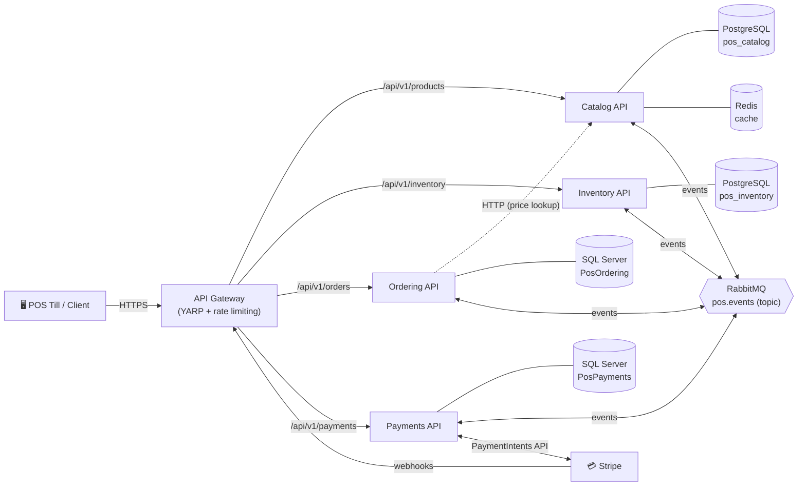
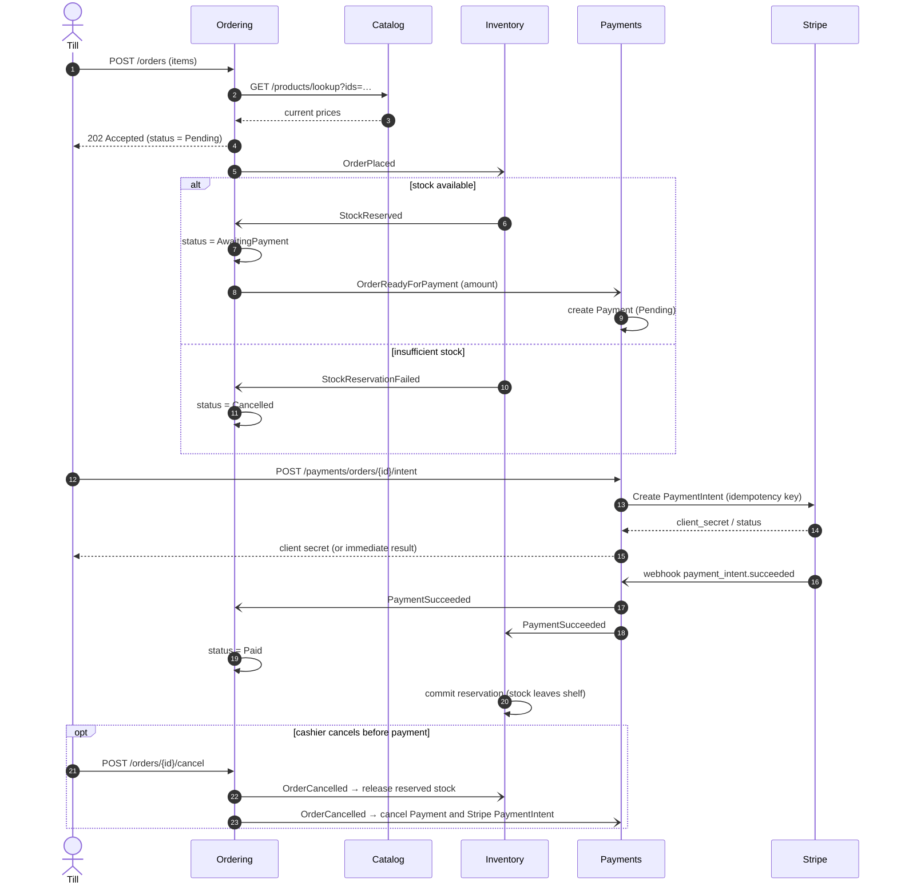
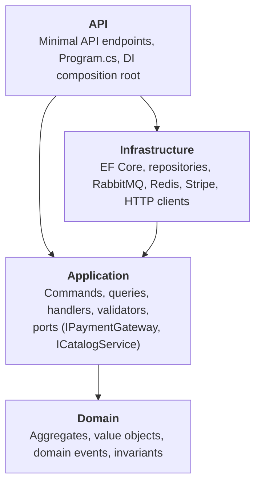

# Point of Sale — .NET 10 Microservices Sample

[](https://github.com/OWNER/sample-pos-microservices-project/actions/workflows/ci.yml)


[](LICENSE)

A sample **Point of Sale (POS)** backend built with **.NET 10 and C#**. It is split into microservices, and **each service follows Clean Architecture**. Services talk to each other through **RabbitMQ** events. A **YARP API gateway** is the single entry point, card payments go through **Stripe**, and everything runs locally with **Docker Compose** or on **Kubernetes**.

> This is a learning and reference project. It shows the patterns a production system needs: transactional outbox, idempotent consumers, saga choreography, retries with dead-lettering, and optimistic concurrency. It stays small enough to read in an afternoon.

---

## Table of contents

- [Features](#features)
- [Architecture](#architecture)
- [Services](#services)
- [The order saga](#the-order-saga)
- [Clean Architecture inside each service](#clean-architecture-inside-each-service)
- [Reliability patterns](#reliability-patterns)
- [Tech stack](#tech-stack)
- [Repository structure](#repository-structure)
- [Getting started](#getting-started)
- [Stripe setup](#stripe-setup)
- [Walkthrough: ring up a sale](#walkthrough-ring-up-a-sale)
- [Deploying to Kubernetes](#deploying-to-kubernetes)
- [API reference](#api-reference)
- [Configuration](#configuration)
- [Coding standards](#coding-standards)
- [Testing](#testing)
- [Production hardening roadmap](#production-hardening-roadmap)
- [License](#license)

---

## Features

- 🧩 **4 microservices + API gateway**: Catalog, Inventory, Ordering, Payments, and a YARP gateway
- 🏛️ **Clean Architecture** in each service: Domain → Application → Infrastructure → API
- 📨 **Event-driven** with RabbitMQ: a topic exchange, one durable queue per service, retries and dead-letter queues
- 📦 **Transactional outbox and inbox**: no lost events and no duplicate processing
- 💳 **Stripe PaymentIntents**: idempotency keys, verified webhooks, decline handling, zero-decimal currencies
- 🗄️ **Polyglot persistence**: PostgreSQL, SQL Server and a Redis cache, each chosen to fit its service
- 🛡️ **Resilience**: HTTP retries, timeouts and circuit breaker; database retry-on-failure; optimistic concurrency
- ☸️ **Kubernetes manifests** (Kustomize): probes, resource limits, HPA, Ingress, non-root and read-only containers
- 🐳 **Docker Compose** brings up the whole stack with one command
- 📖 **OpenAPI + Scalar UI** for every service
- ✅ **Unit tests** for the domain model and the application handlers
- 🔁 **GitHub Actions** CI: format check, build with warnings as errors, tests, and Docker images pushed to GHCR

---

## Architecture



**Communication rules**

| Style | Used for | Example |
|---|---|---|
| Synchronous HTTP (through the gateway) | Client → service commands and queries | `POST /api/v1/orders` |
| Synchronous HTTP (service → service) | Read-only lookups that are needed *right now* | Ordering asks Catalog for current prices |
| Asynchronous events (RabbitMQ) | Everything that changes another service's state | `OrderPlaced` → Inventory reserves stock |

Each service **owns its own database**. No service reads another service's tables.

---

## Services

| Service | Responsibility | Storage | Why this store | Publishes | Consumes |
|---|---|---|---|---|---|
| **Catalog** | Products, prices, categories | PostgreSQL + **Redis** | Read-heavy: Redis cache-aside makes product lookups at the till fast | `ProductCreated` | — |
| **Inventory** | Stock levels and reservations | PostgreSQL | Strong consistency and row-level optimistic concurrency stop overselling | `StockReserved`, `StockReservationFailed` | `ProductCreated`, `OrderPlaced`, `OrderCancelled`, `PaymentSucceeded` |
| **Ordering** | Sales and the order lifecycle (saga) | SQL Server | Transactional aggregate with line items; a common choice for retail back offices | `OrderPlaced`, `OrderReadyForPayment`, `OrderCancelled` | `StockReserved`, `StockReservationFailed`, `PaymentSucceeded` |
| **Payments** | Card payments through Stripe | SQL Server | Financial records need ACID guarantees and an audit trail | `PaymentSucceeded`, `PaymentFailed` | `OrderReadyForPayment`, `OrderCancelled` |
| **Gateway** | Routing, rate limiting, CORS, forwarded headers | — | — | — | — |

> **Why not RavenDB or a JSON document store?** A document database would be a good fit for the Catalog (flexible product attributes). This sample sticks to PostgreSQL, SQL Server and Redis because they are the most widely deployed and have first-class EF Core providers. Because of Clean Architecture, swapping the Catalog to a document store means changing only `Pos.Catalog.Infrastructure`.

---

## The order saga

The checkout flow is a **choreographed saga**. No central orchestrator runs it: each service reacts to events and publishes its own. Each step has a compensating action.



**Order states:** `Pending → AwaitingPayment → Paid`, or `→ Cancelled` from any state before payment.

A **declined card does not cancel the order**. The payment moves to `Failed` and the cashier can retry with another card on the *same* PaymentIntent, so the customer can never be charged twice.

---

## Clean Architecture inside each service



| Layer | Contains | Depends on |
|---|---|---|
| **Domain** | Aggregates (`Order`, `StockItem`, `Payment`, `Product`), value objects (`Money`), domain events, errors, repository interfaces | Nothing except `BuildingBlocks.Domain` |
| **Application** | CQRS commands and queries with handlers, FluentValidation validators, domain/integration event handlers, **ports** for external systems | Domain |
| **Infrastructure** | EF Core `DbContext` and configurations, repositories, Stripe adapter, typed HTTP clients, outbox/inbox, RabbitMQ | Application |
| **API** | Endpoints (`IEndpoint`), `Program.cs`, configuration | Infrastructure (composition only) |

Key rules:

- The **Domain has no framework dependencies**: no EF attributes and no Stripe types.
- Expected failures return a **`Result` / `Result<T>`** with a typed `Error` (Validation, NotFound or Conflict). The API maps these to RFC 9457 `ProblemDetails`. Exceptions are kept for truly unexpected failures.
- Commands go through a **validation decorator**: FluentValidation runs before every command handler.
- Stripe sits behind `IPaymentGateway`, so Payments can be unit tested without the network and the provider could be replaced.

### Shared building blocks

| Project | Purpose |
|---|---|
| `Pos.BuildingBlocks.Domain` | `Entity`, `AggregateRoot`, `IDomainEvent`, `Result`, `Error`, `Money` |
| `Pos.BuildingBlocks.Application` | `ICommand`/`IQuery` + handlers, validation decorators, `IEventBus`, `IUnitOfWork`, `ICacheService`, `PagedResult` |
| `Pos.BuildingBlocks.Infrastructure` | `ServiceDbContext` (unit of work + domain event dispatch), outbox/inbox, RabbitMQ publisher/consumer, Redis cache, DB initializer |
| `Pos.BuildingBlocks.Web` | Service defaults: ProblemDetails, global exception handler, OpenAPI/Scalar, health endpoints, endpoint discovery |
| `Pos.Contracts` | Integration event contracts shared between services |

> The building blocks contain plumbing only, never business logic. Each service's domain stays independent.

---

## Reliability patterns

| Problem | Pattern used | Where |
|---|---|---|
| "Saved the order but the broker was down, so the event was lost" | **Transactional outbox.** Events are written to `outbox_messages` in the same transaction as the business data. `OutboxProcessor` relays them to RabbitMQ. | `BuildingBlocks.Infrastructure/Outbox` |
| "The broker delivered the same message twice" | **Idempotent consumer (inbox).** `(MessageId, Consumer)` is stored atomically with the handler's changes. Duplicates are skipped. | `IdempotentIntegrationEventHandler` |
| "A handler failed with a transient error" | **Retry, then dead-letter.** The message is republished with an `x-retry-count` header (3 times by default), then routed to `<queue>.dlq`. | `RabbitMqConsumer` |
| "Two orders reserved the last unit at the same time" | **Optimistic concurrency.** `StockItem.Version` / `Payment.Version` are concurrency tokens. The losing write raises an exception and the message is retried against fresh data. | Inventory, Payments |
| "Catalog is slow or flaky" | **Standard resilience handler.** Retries with jitter, timeouts and a circuit breaker on the typed `HttpClient`. | Ordering → Catalog |
| "The database restarted" | EF Core `EnableRetryOnFailure()` plus a startup retry loop | All services |
| "The client retried the payment request" | **Stripe idempotency key** `pos-payment-{paymentId}`, and one PaymentIntent per order | `StripePaymentGateway` |
| "Someone forged a webhook" | **Signature verification** with `EventUtility.ConstructEvent` and the endpoint's signing secret | Payments webhook |

Domain events are dispatched **inside** `SaveChangesAsync`, before the commit. Domain event handlers translate them into integration events, so the outbox row and the aggregate change are committed together.

---

## Tech stack

| Concern | Technology |
|---|---|
| Runtime | .NET 10, C# 14, ASP.NET Core Minimal APIs |
| Gateway | YARP reverse proxy, ASP.NET Core rate limiting |
| Messaging | RabbitMQ 4.1 with `RabbitMQ.Client` 7 (async API) |
| Persistence | EF Core 10 with Npgsql (PostgreSQL 17) and SQL Server 2022 |
| Caching | Redis 7 through `IDistributedCache` |
| Payments | Stripe.net (PaymentIntents and webhooks) |
| Validation | FluentValidation |
| Resilience | `Microsoft.Extensions.Http.Resilience` (Polly v8) |
| API docs | Built-in OpenAPI (`Microsoft.AspNetCore.OpenApi`) with the Scalar UI |
| Containers | Docker multi-stage builds, non-root `aspnet` runtime image |
| Orchestration | Kubernetes and Kustomize, NGINX Ingress, HPA |
| CI | GitHub Actions, GHCR |
| Tests | xUnit with hand-written fakes (no mocking library needed) |

---

## Repository structure

```text
.
├── src
│   ├── BuildingBlocks
│   │   ├── Pos.BuildingBlocks.Domain           # DDD primitives, Result, Money
│   │   ├── Pos.BuildingBlocks.Application      # CQRS abstractions, validation decorators
│   │   ├── Pos.BuildingBlocks.Infrastructure   # EF base context, outbox/inbox, RabbitMQ, Redis
│   │   ├── Pos.BuildingBlocks.Web              # Service defaults (ProblemDetails, OpenAPI, health)
│   │   └── Pos.Contracts                       # Integration events
│   ├── Gateway
│   │   └── Pos.Gateway                         # YARP API gateway
│   └── Services
│       ├── Catalog    ── Pos.Catalog.{Domain,Application,Infrastructure,Api}
│       ├── Inventory  ── Pos.Inventory.{Domain,Application,Infrastructure,Api}
│       ├── Ordering   ── Pos.Ordering.{Domain,Application,Infrastructure,Api}
│       └── Payments   ── Pos.Payments.{Domain,Application,Infrastructure,Api}
├── tests
│   ├── Pos.Catalog.UnitTests
│   ├── Pos.Inventory.UnitTests
│   ├── Pos.Ordering.UnitTests
│   └── Pos.Payments.UnitTests
├── deploy/k8s/base                             # Kustomize manifests
├── docs/api-requests.http                      # End-to-end request walkthrough
├── docker-compose.yml
├── Directory.Build.props                       # Shared compiler & analyzer settings
├── Directory.Packages.props                    # Central package management
├── .editorconfig                               # Coding standards (enforced at build)
└── PointOfSale.slnx
```

---

## Getting started

### Prerequisites

- [.NET 10 SDK](https://dotnet.microsoft.com/download/dotnet/10.0)
- [Docker Desktop](https://www.docker.com/products/docker-desktop/) (or Docker Engine with Compose v2)
- A free [Stripe account](https://dashboard.stripe.com/register) (test mode) and the [Stripe CLI](https://docs.stripe.com/stripe-cli)
- *Optional:* `kubectl` plus [kind](https://kind.sigs.k8s.io/), minikube or Docker Desktop Kubernetes

> **Apple Silicon:** the SQL Server image is x64-only. Turn on *"Use Rosetta for x86/amd64 emulation"* in Docker Desktop.

### Option A: run everything with Docker Compose

```bash
git clone https://github.com/OWNER/sample-pos-microservices-project.git
cd sample-pos-microservices-project

cp .env.example .env          # then paste your Stripe TEST keys into .env
docker compose up --build -d
```

| URL | What |
|---|---|
| http://localhost:8080 | **API gateway**. Use this for all API calls. |
| http://localhost:5101/scalar | Catalog API docs |
| http://localhost:5102/scalar | Inventory API docs |
| http://localhost:5103/scalar | Ordering API docs |
| http://localhost:5104/scalar | Payments API docs |
| http://localhost:15672 | RabbitMQ management UI (`pos` / `pos_rabbit_password`) |

Databases are created automatically on startup, and Catalog seeds six demo products. Inventory picks them up through `ProductCreated` events.

### Option B: run the services from your IDE

Start only the infrastructure in Docker, then run the services with `dotnet run` or from Visual Studio / Rider:

```bash
docker compose up -d rabbitmq postgres sqlserver redis

dotnet run --project src/Services/Catalog/Pos.Catalog.Api       # http://localhost:5101
dotnet run --project src/Services/Inventory/Pos.Inventory.Api   # http://localhost:5102
dotnet run --project src/Services/Ordering/Pos.Ordering.Api     # http://localhost:5103
dotnet run --project src/Services/Payments/Pos.Payments.Api     # http://localhost:5104
dotnet run --project src/Gateway/Pos.Gateway                    # http://localhost:8080
```

Keep the Stripe keys out of `appsettings.json` by using **user-secrets**:

```bash
cd src/Services/Payments/Pos.Payments.Api
dotnet user-secrets set "Stripe:SecretKey"      "sk_test_..."
dotnet user-secrets set "Stripe:PublishableKey" "pk_test_..."
dotnet user-secrets set "Stripe:WebhookSecret"  "whsec_..."
```

---

## Stripe setup

1. In the [Stripe Dashboard](https://dashboard.stripe.com/test/apikeys), switch to **Test mode** and copy the **Secret key** (`sk_test_…`) and the **Publishable key** (`pk_test_…`).
2. Forward webhooks to your local gateway with the Stripe CLI:

   ```bash
   stripe login
   stripe listen --forward-to localhost:8080/api/v1/payments/webhooks/stripe \
                 --events payment_intent.succeeded,payment_intent.payment_failed
   ```

   The CLI prints a signing secret (`whsec_…`). Put it in `STRIPE_WEBHOOK_SECRET` (`.env`) or in user-secrets, then restart `payments-api`.
3. Pay with Stripe's [test payment methods](https://docs.stripe.com/testing#cards):

   | Payment method | Result |
   |---|---|
   | `pm_card_visa` | Succeeds |
   | `pm_card_visa_chargeDeclined` | Declined. The payment becomes `Failed` and you can retry. |
   | `pm_card_authenticationRequired` | Requires 3-D Secure (`RequiresAction`) |

**How payments work here**

- One **PaymentIntent per order**. It is created with idempotency key `pos-payment-{paymentId}`, and the order and payment ids are stored in Stripe `metadata`.
- `automatic_payment_methods` is enabled with `allow_redirects = never`, which suits an in-store flow.
- If you send a `paymentMethodId`, the intent is **confirmed server-side** (handy for demos and tests). Otherwise the response contains the **client secret** for Stripe.js / Payment Element on the till UI.
- The **webhook is the source of truth**. Immediate results from confirmation are applied straight away, and the webhook later confirms them idempotently.
- Amounts are converted to minor units, including Stripe's [zero-decimal currencies](https://docs.stripe.com/currencies#zero-decimal) such as JPY.

> For **physical card readers**, use [Stripe Terminal](https://docs.stripe.com/terminal). The same `IPaymentGateway` port can be implemented with `card_present` PaymentIntents without touching the domain or application layers.

---

## Walkthrough: ring up a sale

The same flow is in [`docs/api-requests.http`](docs/api-requests.http) for VS Code, Rider or Visual Studio.

```bash
GW=http://localhost:8080

# 1) Pick a product
curl -s "$GW/api/v1/products?search=latte" | jq '.items[0]'
PRODUCT_ID=<id from above>

# 2) Put stock on the shelf
curl -s -X POST "$GW/api/v1/inventory/$PRODUCT_ID/receive" \
     -H "Content-Type: application/json" -d '{"quantity": 25}' | jq

# 3) Ring up a sale  →  202 Accepted, status "Pending"
ORDER_ID=$(curl -s -X POST "$GW/api/v1/orders" -H "Content-Type: application/json" \
  -d "{\"cashierId\":\"till-01\",\"items\":[{\"productId\":\"$PRODUCT_ID\",\"quantity\":2}]}" | jq -r '.id')

# 4) A moment later Inventory has reserved stock  →  "AwaitingPayment"
curl -s "$GW/api/v1/orders/$ORDER_ID" | jq '.status'

# 5) Take payment (Stripe test card)
curl -s -X POST "$GW/api/v1/payments/orders/$ORDER_ID/intent" \
     -H "Content-Type: application/json" -d '{"paymentMethodId":"pm_card_visa"}' | jq

# 6) Order is "Paid"; on-hand stock dropped by 2
curl -s "$GW/api/v1/orders/$ORDER_ID" | jq '.status'
curl -s "$GW/api/v1/inventory/$PRODUCT_ID" | jq
```

Watch the events go by in the RabbitMQ UI (**Queues** tab: `pos.inventory`, `pos.ordering`, `pos.payments`).

---

## Deploying to Kubernetes

The manifests in [`deploy/k8s/base`](deploy/k8s/base) are plain Kustomize. They include:

- A `pos` namespace, a ConfigMap, and a Secret generated from `secrets.env`
- StatefulSets for RabbitMQ, PostgreSQL and SQL Server (with PVCs), and a Deployment for Redis
- 2 replicas of each service, with **startup, liveness and readiness probes** (`/health/live`, `/health/ready`)
- Hardened pods: `runAsNonRoot`, `readOnlyRootFilesystem`, all capabilities dropped, `seccompProfile: RuntimeDefault`
- Resource requests and limits, rolling updates with `maxUnavailable: 0`
- **HPA** for the gateway and Ordering (needs metrics-server)
- An NGINX **Ingress** for the gateway at `pos.localtest.me`

### 1. Build the images

```bash
for svc in catalog-api:Services/Catalog/Pos.Catalog.Api \
           inventory-api:Services/Inventory/Pos.Inventory.Api \
           ordering-api:Services/Ordering/Pos.Ordering.Api \
           payments-api:Services/Payments/Pos.Payments.Api \
           gateway:Gateway/Pos.Gateway; do
  name=${svc%%:*}; path=${svc#*:}
  docker build -f src/$path/Dockerfile -t pos/$name:latest .
done
```

For **kind**, load the images into the cluster (`kind load docker-image pos/catalog-api:latest …`). For a remote cluster, push them to a registry and update the `images:` section in `kustomization.yaml`. CI already publishes them to `ghcr.io/<owner>/pos-<service>`.

### 2. Create the secrets file

```bash
cp deploy/k8s/base/config/secrets.env.example deploy/k8s/base/config/secrets.env
# edit secrets.env: Stripe keys, database and RabbitMQ passwords
```

`secrets.env` is git-ignored. In production, use an external secret store, for example the External Secrets Operator with Azure Key Vault, AWS Secrets Manager or HashiCorp Vault.

### 3. Deploy

```bash
kubectl apply -k deploy/k8s/base
kubectl -n pos get pods -w
```

### 4. Reach the gateway

```bash
# With an NGINX ingress controller installed:
curl http://pos.localtest.me/api/v1/products

# Or without an ingress:
kubectl -n pos port-forward svc/gateway 8080:80
```

For Stripe webhooks in a cluster, expose the gateway publicly and add a webhook endpoint in the Stripe Dashboard pointing at `https://<your-host>/api/v1/payments/webhooks/stripe`. Locally, keep using `stripe listen` with the port-forward.

---

## API reference

All routes go through the gateway (`http://localhost:8080`). Errors are returned as RFC 9457 `application/problem+json` with a machine-readable `code` and a `traceId`.

### Catalog: `/api/v1/products`

| Method | Route | Description |
|---|---|---|
| GET | `/api/v1/products?search=&category=&page=&pageSize=` | List active products (paged) |
| GET | `/api/v1/products/{id}` | Get a product (Redis cache-aside) |
| GET | `/api/v1/products/lookup?ids=…&ids=…` | Batch lookup (used by Ordering) |
| POST | `/api/v1/products` | Create a product → `201 Created` |
| PUT | `/api/v1/products/{id}` | Update name, description and category |
| PUT | `/api/v1/products/{id}/price` | Change the price |
| DELETE | `/api/v1/products/{id}` | Deactivate (soft delete) |

### Inventory: `/api/v1/inventory`

| Method | Route | Description |
|---|---|---|
| GET | `/api/v1/inventory?page=&pageSize=` | List stock levels |
| GET | `/api/v1/inventory/{productId}` | Stock for one product (on hand, reserved, available) |
| POST | `/api/v1/inventory/{productId}/receive` | Receive goods `{ "quantity": 10 }` |

### Ordering: `/api/v1/orders`

| Method | Route | Description |
|---|---|---|
| POST | `/api/v1/orders` | Place an order → `202 Accepted` |
| GET | `/api/v1/orders/{id}` | Get an order with its lines |
| GET | `/api/v1/orders?status=&page=&pageSize=` | List orders, newest first |
| POST | `/api/v1/orders/{id}/cancel` | Cancel an unpaid order `{ "reason": "…" }` |

### Payments: `/api/v1/payments`

| Method | Route | Description |
|---|---|---|
| GET | `/api/v1/payments/config` | Stripe publishable key for the till UI |
| GET | `/api/v1/payments/orders/{orderId}` | Payment status for an order |
| POST | `/api/v1/payments/orders/{orderId}/intent` | Create or resume the PaymentIntent `{ "paymentMethodId": "pm_card_visa" }` (body optional) |
| POST | `/api/v1/payments/webhooks/stripe` | Stripe webhook receiver (signature verified) |

Every service also exposes `/health/live`, `/health/ready`, and (in Development) `/openapi/v1.json` and `/scalar`.

---

## Configuration

Settings use the standard ASP.NET Core configuration order: `appsettings.json` → environment variables → user-secrets. Use `__` for nesting in environment variables, for example `RabbitMq__HostName`.

| Key | Service(s) | Description |
|---|---|---|
| `ConnectionStrings:CatalogDb` / `InventoryDb` | Catalog / Inventory | PostgreSQL connection strings |
| `ConnectionStrings:OrderingDb` / `PaymentsDb` | Ordering / Payments | SQL Server connection strings |
| `ConnectionStrings:Redis` | Catalog | Redis endpoint |
| `RabbitMq:HostName`, `Port`, `UserName`, `Password`, `VirtualHost` | All | Broker connection |
| `RabbitMq:QueueName` | All | This service's durable queue (`pos.catalog`, `pos.inventory`, …) |
| `RabbitMq:ExchangeName` | All | Shared topic exchange (default `pos.events`) |
| `RabbitMq:PrefetchCount` / `MaxRetryCount` | All | Consumer QoS and redelivery attempts before dead-lettering |
| `Outbox:PollingIntervalSeconds` / `BatchSize` / `MaxAttempts` | All | Outbox relay tuning |
| `Services:Catalog:BaseUrl` | Ordering | Catalog API base URL |
| `Stripe:SecretKey` / `PublishableKey` / `WebhookSecret` | Payments | Stripe credentials |
| `ReverseProxy:*` | Gateway | YARP routes and clusters |
| `RateLimiting:PermitLimit` / `WindowSeconds` | Gateway | Fixed-window rate limit per client IP |
| `Cors:AllowedOrigins` | Gateway | Origins allowed to call the API from a browser |

Options are bound with `ValidateDataAnnotations().ValidateOnStart()`, so a missing or invalid setting stops the service at startup instead of failing later.

---

## Coding standards

The standards are **enforced by the build**, not only written down:

- **`TreatWarningsAsErrors`**, plus .NET analyzers at `AnalysisMode=Recommended`, plus `EnforceCodeStyleInBuild`
- **`.editorconfig`** defines naming (`_camelCase` private fields, `I` interface prefix, `Async` suffix), file-scoped namespaces, required braces and accessibility modifiers, and no unused `using`s
- **Nullable reference types** are on everywhere
- **Central package management** (`Directory.Packages.props`): one version per dependency across the solution
- `dotnet format --verify-no-changes` runs in CI

Conventions used throughout:

- `sealed` by default; `internal` for handlers, configurations and endpoints that are not part of a public contract
- Primary constructors for dependency injection; **async all the way**, with a `CancellationToken` on every I/O call
- **High-performance logging** with `[LoggerMessage]` source generators
- `TimeProvider` instead of `DateTime.Now`, so time is testable
- `Guid.CreateVersion7()` for time-ordered, index-friendly ids
- No primitive obsession for money: the `Money` value object handles currency and rounding
- Encapsulated aggregates: private setters, `IReadOnlyCollection` navigations, and invariants enforced in the domain methods
- One feature per folder in the Application layer (`Orders/PlaceOrder/…`)

---

## Testing

```bash
dotnet test PointOfSale.slnx
```

| Project | Covers |
|---|---|
| `Pos.Catalog.UnitTests` | `Money` value object, `Product` aggregate rules and events |
| `Pos.Inventory.UnitTests` | Reserve / release / commit, overselling protection, idempotency, versioning |
| `Pos.Ordering.UnitTests` | Order state machine, totals, line merging, and `PlaceOrderCommandHandler` with fake Catalog and repository |
| `Pos.Payments.UnitTests` | Payment state machine, `CreatePaymentIntentCommandHandler` with a fake gateway (success, decline, retry, already paid), Stripe minor-unit conversion |

**Suggested next step:** integration tests with [Testcontainers for .NET](https://dotnet.testcontainers.org/) (PostgreSQL, SQL Server and RabbitMQ) and `WebApplicationFactory`.

---

## Production hardening roadmap

This sample deliberately leaves the following out to stay focused:

- [ ] **Authentication and authorization.** Validate JWTs (OIDC: Entra ID, Auth0 or Keycloak) at the gateway and in each service, with cashier and manager roles.
- [ ] **EF Core migrations.** Replace `EnsureCreated` with migration bundles run as a Kubernetes `Job` or init container.
- [ ] **Observability.** OpenTelemetry traces, metrics and logs exported to Grafana, Jaeger or Azure Monitor, with correlation ids across RabbitMQ.
- [ ] **Outbox at scale.** Use `FOR UPDATE SKIP LOCKED` (PostgreSQL) or `READPAST` (SQL Server) when running many replicas. Consumers are already idempotent.
- [ ] **Refunds and returns** through Stripe Refunds, plus **Stripe Terminal** for card-present payments.
- [ ] **Managed infrastructure.** Use managed PostgreSQL, SQL Server and Redis, and RabbitMQ via the Cluster Operator, instead of in-cluster StatefulSets.
- [ ] A **Helm chart** or Kustomize overlays (`dev` / `staging` / `prod`), plus NetworkPolicies and PodDisruptionBudgets.
- [ ] **Read models** (CQRS) for reporting, such as daily sales and top products.

---

## License

This project is licensed under the [MIT License](LICENSE).

> Stripe is a trademark of Stripe, Inc. This sample is not affiliated with or endorsed by Stripe.
